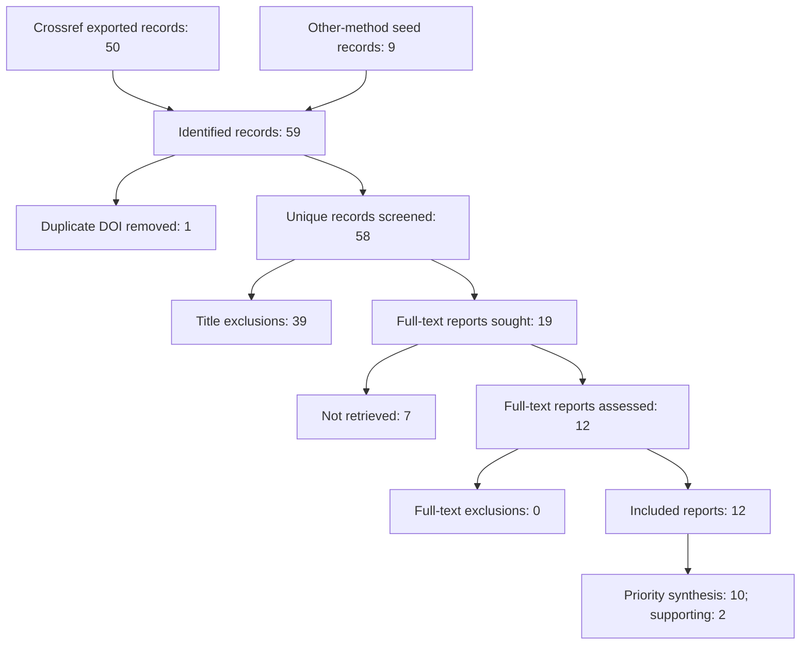

# Reconciled report flow

Search date: 2026-10-25. Counts derive from screening_register.csv; zero is a real count, not a placeholder.

59 - 1 = 58; 58 - 39 = 19; 19 - 7 = 12; 12 - 0 = 12 reports. The number of independent studies is unresolved. This diagram is generated locally, **not** using the official PRISMA app required by slide 44; do not mark that specific tool requirement complete until it has been exported there. Official tool: https://www.prisma-statement.org/prisma-2020-flow-diagram .

Not retrieved: C01/C31/C41/C49 publisher preview or restricted access; C07 access challenge; C10 restricted publisher access; C22 unresolved DOI. These are retrieval failures, not methodological-quality exclusions. Their canonical DOI links are in the register. No fabricated reason for full-text exclusion is added.

Official Shiny app attempt on 2026-10-25: `The application failed to start. signal: killed`. A second web access timed out. The tool-specific export is blocked by application availability, not replaced with invented evidence.
