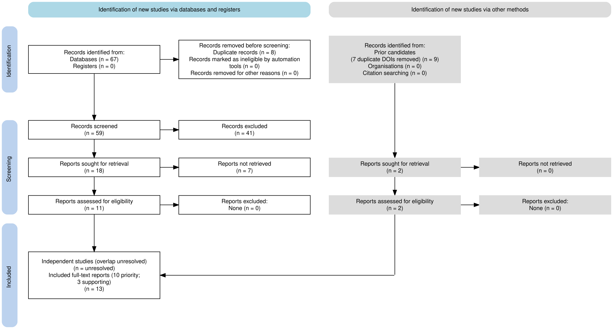

# PRISMA 2020 report flow

[PDF](prisma_official/flow.pdf) · [SVG](prisma_official/flow.svg) · [Tracked input](prisma_official_input.csv) · [Execution evidence](prisma_official/execution.json).

Generated with PRISMA2020 version 1.1.5, the package behind the Shiny tool linked by the official PRISMA website. The web app failed earlier; the official-linked package has now been run successfully in GitHub Actions, including SVG/PNG/PDF export. No custom figure is passed off as an official-tool export.

The database arm contains67 records (50Crossref and17Semantic Scholar):8duplicates removed,59screened,41excluded,18reports sought,7not retrieved and11full texts included. The other-method arm contains9prior records:7duplicates removed and2unique reports retrieved and included. Combined:76identified -15duplicates =61unique;61 -41 =20reports sought;20 -7 =13included reports, with10priority and3supporting reports. No full-text report was excluded after assessment. Independent-study count remains unresolved because several reports may share source data.

Seven inaccessible reports: C01/C31/C41/C49 publisher preview/restricted access; C07 access challenge; C10 restricted publisher access; C22 unresolved DOI. Retrieval failure is not scientific exclusion. Their canonical links are preserved in the register.

Citation: Haddaway, Page, Pritchard and McGuinness(2022), PRISMA2020, Campbell Systematic Reviews18:e1230, https://doi.org/10.1002/cl2.1230 . Official tool link: https://www.prisma-statement.org/prisma-2020-flow-diagram .
