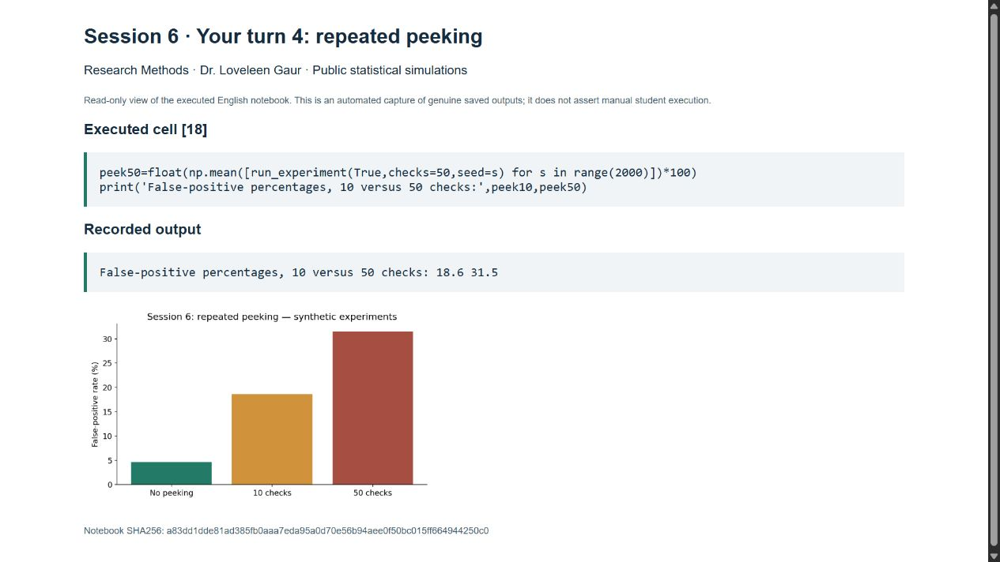

# Research Methods Portfolio — Sessions 1–7

Dr. Loveleen Gaur · Doctoral Program in Deep Technologies · UNMSM

Repository owner: bamigdim1153

Submission prepared: 25 October 2026

Repository: https://github.com/bamigdim1153/Split_Optimization

## Scope and evidence

The research proposal concerns one southern-Peruvian underground mine using sublevel stoping. Operational context was reported by the student. The implemented prototype uses 120 explicitly synthetic events; public Wisconsin data support the supplied course exercises. These outputs do not describe company records, field trials or demonstrated cost savings. The reflection was confirmed by the student. Code, literature extraction and document preparation used AI assistance, disclosed in control/provenance.md.

The portfolio contains the seven deliverables, their verification and supporting files. Two external handoff actions remain: coordinate the individual article choice with the class (other selections are unknown) and upload the files/link to the assigned course platform. No grade or submission receipt is asserted.

## Contents

1. Paradigm justification
2. Method-fit matrix
3. Complete research protocol, calendar and planning budget
4. Mini-review, PRISMA flow, critical appraisal and gap table
5. Reproducible pipeline and experiment evidence
6. Published-paper audit, labs, reflection and exit ticket
7. Own Model Card/Datasheet, benchmarking, ablation and documentation

The standalone one-page Session 1/2/oral Session 3 PDFs remain in their folders. The complete ten-heading protocol below supplements the earlier oral version that deferred the abstract/review. The full-size official-package PRISMA vector diagram is supplied separately and appended to this PDF.

<!-- PAGEBREAK -->
# Session 1 — Paradigm justification

## Session 1 — Paradigm Justification Statement

## 1. Research topic and context

The study concerns production stopes mined by sublevel stoping at one underground mine in southern Peru. The researcher reports high explosive consumption, oversize fragments, elevated transport costs relative to monthly budget references, and missed monthly tonnage targets; these observations require verification against records. A prototype will connect fragmentation prediction with economic assessment of design alternatives. Its immediate relevance concerns this operation, without claiming generalization across Peru.

## 2. Preliminary research question

To what extent can a fragmentation-prediction prototype support design decisions that improve the balance of drilling, explosives, loading, transport and secondary-breaking costs in this sublevel-stoping operation?

## 3. Selected paradigm and justification

Design science is proposed because the intended contribution is to build and evaluate a decision-support artifact. Diagnosis, requirements, development and evaluation will be connected to the current standard design. An exclusively positivist orientation is not selected as the main approach because the purpose extends beyond testing associations to developing an evaluated solution, although quantitative hypothesis testing will support evaluation. Interpretivism is not selected as the main orientation because meaning-making and lived experience are not the central research questions. Mixed methods are not selected because no necessary qualitative question has yet been identified. These approaches answer different purposes and are not inferior alternatives. Artifact utility, performance and limitations will determine the coherence of the approach [M1].

## 4. Implications

The student reports 120 historical blasts and projects approximately 180 new events over at least six months, subject to data quality and permissions. Simple and ML predictors will be compared without assuming a winner; development and prospective validation will be separated. Split Desktop measurements after transport describe material at that stage, not directly at the original face. The prototype and reproducible protocol are candidate contributions whose novelty requires literature review. Mining Technology and Mining are preliminary thematic publication venues, not guaranteed outlets [R01, R03].

## 5. One doubt or tension

General Management authorization for design trials is the main uncertainty; academic-use and publication permissions must also be clarified. If trials are not authorized, conclusions will concern predictions and analytical comparisons, without claiming field-demonstrated causal savings.

References: [bibliography](../session_04/references.md), M1, R01 and R03. Draft for the student's review and defense.

<!-- PAGEBREAK -->
# Session 2 — Method-fit matrix

## Session 2 — Method-Fit Matrix

Question: how should a predictive decision-support artifact and its economic usefulness be developed and evaluated in one sublevel-stoping operation?

The alternatives are research strategies, not algorithms. Scores and weights are proposed judgments for student review.

| Criterion | Weight | A: design science with quantitative evaluation | B: longitudinal quantitative case study without a recommender | C: quasi-experimental operational change using current tools |
|---|---:|---:|---:|---:|
| E: epistemological fit | 30 | 5 | 4 | 4 |
| D: data availability | 20 | 4 | 4 | 3 |
| F: feasibility | 25 | 3 | 4 | 2 |
| C: contribution type | 15 | 5 | 3 | 4 |
| V: venue fit | 10 | 4 | 4 | 4 |
| Gate: E <= 2 eliminates | — | Survives | Survives | Survives |
| Weighted mean /5 | 100 | 4.20 | 3.85 | 3.30 |

Proposed calculation: sum(weight × score)/100, after applying the gate. This formula is explicit here and is not attributed as a dictated course formula.

**A:** E5/C5 reflect the artifact objective; D4 reflects reported data with quality/permissions unverified; F3 reflects development and authorization demands; V4 reflects thematic precedent, not editorial acceptance.

**B:** E4 supports a coherent association study; D4/F4 reflect lower intervention demands, still requiring academic-use permission; C3 would not deliver the entire intended artifact; V4 is preliminary thematic fit.

**C:** E4/C4 support studying an operational change; D3 depends on future interventions; F2 reflects authorization and confounding difficulties; V4 depends on methodological quality.

**Proposed selection: A.** B remains a legitimate lower-intervention alternative; C can become an evaluation phase. The matrix does not imply that ML must outperform a simpler model. Highest weight: epistemological fit, because the strategy must match the knowledge/artifact sought. Lowest weight: venue fit, because coherence and feasibility precede editorial preference.

**Open tension:** reassess feasibility if trials are denied. Equal-weight sensitivity yields A4.2, B3.8 and C3.4; this does not establish universal robustness.

Source: Session 2 PPT, internal slides 30, 39 and 40.

<!-- PAGEBREAK -->
# Session 3 — Research protocol

## Protocol v0.2 — complete PPT structure, supplementary to the one-page oral version

The existing protocol.md/PDF preserves the oral instruction to defer the abstract and review. This supplementary version supplies all ten PPT headings without silently changing that earlier submission. Proposed study; no real-company results or approvals.

## 1. Title
A fragmentation-prediction prototype for economic assessment of blast-design decisions in sublevel stoping at one underground mine in southern Peru.

## 2. Abstract
This proposed study will develop and evaluate a decision-support prototype for production stopes using sublevel stoping. Reported problems include excessive explosive consumption, oversize and transport-budget deviations. After authorization, approximately 120 historical events will be audited and approximately 30 new events per month observed for at least six months. P80 measurement, event traceability and cost units will be standardized. Simple, empirical where applicable, and machine-learning predictors will use common group/time-aware evaluation. New-event predictions will be timestamped before observing outcomes. Economic assessment will distinguish predictive performance from the causal effect of operational changes; field trials require separate technical authorization. Expected outputs are an evaluated prototype, reproducible evidence and explicit limitations, including negative results.

## 3. Introduction/problem
The reported standard design uses AEGIS and technical calculations. High explosive use and oversize may contribute to downstream costs, but their magnitudes and causal relationships are unverified. Monthly tonnage targets, budget and compatible cost indicators will support diagnosis; no percentage saving is promised.

## 4. Literature review
The bounded Session 4 synthesis inspects thirteen full-text reports, with ten priority papers. Underground bench work (R01), caving measurements (R05/R06), tunnel comparisons (R10) and quarry/compiled-data prediction (R03/C14/R09/R11) inform different parts of the design. P50, mean size, oversize and P80 cannot be substituted. R12 includes percentile modeling but is caving-specific. The current evidence supports a scoped contextual/methodological question, not a global novelty claim. Search limitations and official-tool provenance are documented in session_04/search_log.md and prisma_status.md.

## 5. Questions, hypothesis and objectives
Primary predictive question: how accurately can P80 be predicted for future events at this operation relative to a training-mean baseline, regularized regression and an applicable empirical comparator? Proposed hypothesis: a model chosen using development data improves future-event MAE/RMSE under a common frozen protocol; no minimum effect is invented. Economic question: how do fragmentation and oversize relate to compatible total unit costs after accounting for geology, distance, fleet and availability? Objectives are to audit data, establish measurement validity, compare predictors, validate prospectively and evaluate authorized alternatives. A design change and its savings require a separately justified comparison, beyond prediction.

## 6. Methodology
Design science with quantitative evaluation in one mine. Reported 120 historical events and projected 180 future events are planning figures, not a sample-size justification. Define the event/ring/stope unit before analysis; repeated images/buckets are clustered. Audit traceability and missingness rather than treating the reported 90% as measured coverage. Record Split Desktop calibration and post-transport sampling. Features must be available before the prediction time. Hold out events by time/groups; select models and preprocess only inside development data. Freeze and timestamp predictions, evaluate before retraining, and retain version hashes. Report uncertainty and failure cases, not only the best seed. Use the separate evaluation_plan.md for cost denominators and confounding controls.

## 7. Ethics and permissions
General Management approval is pending. Request distinct permissions for academic analysis, anonymized publication and any field trial. Confirm university review requirements. Keep company data outside the public repository; obtain approval for each release. The current public pipeline uses only synthetic/public teaching data.

## 8. Expected outcomes/contribution
A validated measurement/data protocol, an evaluated prototype and reproducible comparative results. Negative results are acceptable. Potential contribution is a locally evaluated workflow connecting prediction with economic evidence; uniqueness and transferability are not established by this mini-review.

## 9. Proposed timeline and research budget

**Planning scenario, not an approved company budget or a vendor quotation.** Proposed calendar: November 2026-April 2027. Six complete observation months begin only after written academic-use authorization; a later approval shifts the schedule. Approximately30 future events/month and180 over six months are planning assumptions reported by the student, not completed observations or a power calculation.

| Month | Proposed activity and decision gate |
|---|---|
| November 2026 (M1) | Obtain permissions, define the event unit and measurement protocol, audit authorized historical data, freeze analysis plan; start observation only after approval |
| December 2026 (M2) | Establish simple/empirical baselines, training-only preprocessing and group/time-aware development |
| January 2027 (M3) | Select and freeze the prototype using development data; prepare timestamped future-event predictions |
| February 2027 (M4) | Prospective evaluation before updates; examine measurement and cost linkage |
| March 2027 (M5) | Continue observation and failure analysis; update only after scoring and versioning |
| April 2027 (M6) | Complete six authorized collection months where the start date permits; final comparative analysis and reporting afterward |

Current budget covers observation, data preparation and prototype evaluation. Operational design trials are a separately approved future stage, with their own technical review and budget; they are not silently costed as zero here.

| Category | Explicit illustrative estimation basis | Proposed USD |
|---|---|---:|
| Historical data audit |40hours x USD 10/hour |400 |
| Prospective image processing |180events x0.5hour x USD 10/hour |900 |
| Measurement quality checks |18events x0.5hour x USD 10/hour |90 |
| Model development and reporting |60hours x USD 10/hour |600 |
| Computing/storage allowance |6months x USD 15/month |90 |
| Incremental software licenses |USD 0 only in the scenario where existing licenses expressly permit the research use |0 |
| Subtotal |Sum of illustrative scenario costs |2080 |
| Contingency |10% of subtotal |208 |
| Total planning scenario |Includes imputed labor; funding and rates require validation |2288 |

USD 10/hour, task durations and the computing allowance are transparent planning assumptions introduced for this proposal, not observed payroll/vendor prices. Researcher time may be an in-kind contribution rather than a cash payment. If license rights, staffing, image workload or computing needs differ, revise the scenario before requesting funding. No payment or commitment has been made. The operational monthly explosives/transport budget is an outcome comparator, separate from this research budget.

## 10. Bibliography
Hevner et al. (2004), DOI 10.2307/25148625 (design science); Shields et al. (2025), DOI 10.1177/25726668241301880; Amoako et al. (2022), DOI 10.3390/mining2020013; Manzoor et al. (2023), DOI 10.1016/j.ijrmms.2023.105433. Full reviewed report metadata and links: ../session_04/extraction_and_appraisal.csv. Methodological reference and candidate background: ../session_04/references.md.

## Evaluation plan

1. Freeze protocol and permissions before comparing models.
2. Audit event/stope/image IDs, dates, units, missingness, duplicates and cost linkage. The reported approximately 90% traceability is not a measured coverage result.
3. Predict before blasting; do not use observed P80, subsequent costs or realized tonnage as features if unavailable at prediction time.
4. Document Split Desktop sampling, scale, calibration, image count and measurement after transport. Origin identification does not eliminate measurement bias.
5. Separate development and test by time/groups; multiple images of one event are not independent events. State whether testing concerns new events in known stopes or unseen stopes.
6. Fit imputation, scaling and tuning only within training. Seed variation is not complete uncertainty or independent mine replication.
7. Predictive baselines: training mean, regularized regression and an empirical model if assumptions/inputs apply. AEGIS standard design is the operational comparator; do not call it a P80 predictor unless that module is verified.
8. Timestamp predictions before outcomes are known; evaluate first, update afterward under a new version.
9. Field changes require authorization, technical review and a comparison plan addressing geology, distance, fleet, shifts and availability. The synthetic demo cannot recommend operational charges or layouts.
10. Use compatible cost denominators and avoid double counting. Monthly explosives intensity = sum(kg)/sum(t); transport intensity = sum(USD)/sum(t×km). Do not average unweighted ratios or add USD/(t·km) directly to USD/t. Total compatible cost/t = sum(monetary costs)/sum(t). Compare budget and production within the same month.

No acceptable P80 threshold has yet been defined. Do not inherit the old surface-mining proposal's 18–20 cm target without evidence. Prospective economic effects and external generalization remain untested.

<!-- PAGEBREAK -->
# Session 4 — Mini-review

## Mini review: fragmentation prediction and operational evaluation

Review question: which fragmentation outcomes and validation methods can inform a P80 predictor for one southern-Peruvian sublevel-stoping mine, and what evidence connects prediction to downstream costs?

## Search and selection

A bounded AI-assisted review was completed on 25 October 2026. Crossref supplied 50 exported records, Semantic Scholar's web interface supplied 10 broad-query records plus seven exact known-item matches, and the prior candidate list supplied nine records. The combined 76 records contained 15 DOI duplicates. Of 61 unique records, 41 were excluded by title/date, 20 reports were sought, seven were inaccessible and 13 full texts were assessed and included. Ten form the priority synthesis below; three provide supporting context. See screening_register.csv and search_log.md. No independent-study total or exhaustive coverage is claimed.

The primary API failed, but Semantic Scholar's UI worked. The post-hoc exact-title checks are disclosed; they cannot retrospectively turn the original candidate discovery into an unbiased database search. The first broad page is a small relevance-ranked sample. These limitations constrain novelty claims.

## Ten priority reports and critical appraisal

### C08 — Effect of the Inter-Ring Delay Time on Rock Fragmentation: Field Tests at the Underground Mine

[Chen, Hui; Liu, Chengyu; Feng, Yin; Yin, Haojie (2024); DOI 10.3390/app14146372](https://doi.org/10.3390/app14146372). Underground field comparison. Field tests at Beizhan iron mine. Target: Fragmentation distribution and economic indicators. Compares an existing design with alternatives; image-based outcomes. Appraisal: Useful underground field evidence; site-specific comparison does not establish a transport-cost effect at the proposed mine. Full-text locator: Methods and field-test/results sections.

### C14 — Performance evaluation of rock fragmentation prediction based on RF‐BOA, AdaBoost‐BOA, GBoost‐BOA, and ERT‐BOA hybrid models

[Zhao, Junjie; Li, Diyuan; Zhou, Jian; Armaghani, Danial J.; Zhou, Aohui (2024); DOI 10.1002/dug2.12089](https://doi.org/10.1002/dug2.12089). Compiled blasting data; not local stoping. 102 observations; seven inputs. Target: X50 as defined by the authors. RF/AdaBoost/GBoost/ERT with Bayesian optimization; RMSE, MAE and R2. Appraisal: Target is not P80; optimizer and small-data split need independent grouped/prospective validation. Full-text locator: Data and methods; model evaluation.

### C27 — Percentile Fragment Size Predictions for Blasted Rock and the Fragmentation–Energy Fan

[Ouchterlony, Finn; Sanchidrián, José A.; Moser, Peter (2016); DOI 10.1007/s00603-016-1094-x](https://doi.org/10.1007/s00603-016-1094-x). Laboratory/field fragmentation methodology. Historical experimental datasets. Target: Percentile fragment-size predictions. Fragmentation-energy fan framework across percentiles. Appraisal: Supports specifying the percentile explicitly; not a learned model validated in this mine. Full-text locator: Percentile framework and validation examples.

### R01 — Underground bench blast fragmentation: Comparison of a multivariate regression model to established predictive models

[Shields, L.; Calnan, J.; Silva, J.; Agioutantis, Z. (2025); DOI 10.1177/25726668241301880](https://journals.sagepub.com/doi/10.1177/25726668241301880). Underground bench blasting. 38 tabulated tests; confidential site. Target: Fragment-size distributions. Multivariate regression versus modified Kuz-Ram and KCO; random validation subset; error metrics. Appraisal: NDA restricts provenance; random validation at one context is not prospective sublevel-stoping evidence. Full-text locator: Methodology/Table 1 and model comparison.

### R03 — Rock Fragmentation Prediction Using an Artificial Neural Network and Support Vector Regression Hybrid Approach

[Amoako, R.; Jha, A.; Zhong, S. (2022); DOI 10.3390/mining2020013](https://doi.org/10.3390/mining2020013). Compiled multi-mine surface blast data. 102 blasts; 90 training and 12 testing. Target: Mean fragment size. ANN and SVR; five-fold model selection; scaling. Appraisal: Test selection matches Kuznetsov predictions to actual size, so the holdout is not a neutral sample; not P80. Full-text locator: Sections 4.1 and 4.2.

### R05 — Modelling the relationship between oversize fragments and nature of rock mass for a sublevel caving operation

[Manzoor, S.; Gustafson, A.; Schunnesson, H. (2023); DOI 10.1016/j.ijrmms.2023.105433](https://ltu.diva-portal.org/smash/record.jsf?pid=diva2%3A1751901). Malmberget sublevel caving. Eight rings; drilling and bucket observations. Target: Oversize proportion. Multiple linear regression and partial least squares; reported R2 0.78 and 0.73. Appraisal: Many drilling/bucket rows are clustered; caving differs from stoping and measurement coverage matters. Full-text locator: Field data, analysis and conclusions.

### R06 — Rock fragmentation measurements in sublevel caving: field tests at LKAB’s Malmberget mine

[Manzoor, S.; Gustafson, A.; Schunnesson, H.; Tariq, M.; Wettainen, T. (2022); DOI 10.36487/ACG_repo/2205_26](https://papers.acg.uwa.edu.au/p/2205_26_Manzoor/). Malmberget sublevel caving. 7258 assessed buckets from over 15000 videos. Target: QRS size classes and X50-related measurement. Field image/video measurement protocol. Appraisal: Buckets are not independent blasts; no P80 prediction or direct savings test; possible dataset overlap with R05. Full-text locator: Field-test and measurement sections.

### R11 — Prediction of Rock Fragmentation by Blasting Using Symbolic Regression and Explainable Artificial Intelligence

[Ozyurt, M. C. (2026); DOI 10.3390/app16157673](https://www.mdpi.com/2076-3417/16/15/7673). Quarries. 221 subsets; 63 blasts; 16 quarries. Target: P50. Symbolic regression and explainability; Blast_ID split: 50 train/13 test blasts; grouped internal validation. Appraisal: Good example of event grouping; quarry data and P50 do not establish transport savings or transfer to underground stoping. Full-text locator: Sections 3.1-3.3.

### R12 — Impact of blast design parameters on rock fragmentation in sub-level caving: A multivariate regression approach

[Khodayari, A.; Xu, C.; Dare-Bryan, P.; Dowd, P.; Lapcevic, V.; Metcalfe, A. (2026); DOI 10.1016/j.jrmge.2025.07.038](https://digital.library.adelaide.edu.au/items/692d5d1e-454b-433a-9294-bab89826634a). Ernest Henry sublevel caving. Field reference data and 34 modeled scenarios. Target: P20, P50 and P80. Multivariate regression with numerical fragmentation modeling. Appraisal: Relevant percentile coverage; simulated scenarios are not 34 independent field trials; caving differs from stoping. Full-text locator: Methodology, modeling and regression results.

### S09 — Preliminary Blast Fragmentation Modeling in an Underground Aggregate Operation

[Shields, L.; Calnan, J.; Silva, J.; Maldonado, E.; Agioutantis, Z. (2024); DOI 10.56952/ARMA-2024-0053](https://doi.org/10.56952/ARMA-2024-0053). Underground aggregate modeling; compiled-data development. Multivariate analysis using data assembled from five literature sources. Target: 20%, 50% and 80% passing sizes. Multivariate regression; initial fitted relationships; external prediction/validation proposed as future work. Appraisal: Relevant percentile targets, but fitted significance is not prospective predictive accuracy; source-data overlap with related Shields reports must be checked. Full-text locator: ARMA 2024 paper 0053, methods and conclusions, six pages.

## Interpretation and proposed research response

Prediction, measurement validity and economic benefit need separate evidence. The proposed study will specify P80 and its measurement stage, preserve event/image/stope lineage, use time/group-aware validation and compare against simple and applicable empirical baselines. P50, mean size, oversize and P80 are different targets. Caving, underground benches, tunnelling and quarries supply methodological context; none automatically validates transfer to this mine. A prediction model alone cannot establish cost savings caused by a design change.

The supporting reports R09, R10 and C29 remain in the extraction table. R09 and R10 were not found by the exact-title Semantic Scholar checks; they are retained from the documented other-method search, not falsely described as indexed matches. The ten priority reports have actual Semantic Scholar links in semantic_scholar_searches.json.

R05/R06 share the Malmberget setting; S09 and related Shields reports may reuse earlier data; R03/C14/R09 use compiled datasets with potential overlap. Reports are not independent experiments. No pooled sample size, effect estimate or ranking of cross-study error metrics is justified. Access restrictions, single assisted screening, short result export and targeted confirmation can miss contradictory evidence. The four candidate gaps are scoped to this inspected set.

## Evidence-linked candidate gap table

These are scoped candidate gaps in the inspected set, not claims that nobody worldwide has studied the issue.

| Type requested in Session 4 | Candidate gap and inspected evidence | Proposed response and falsifier |
|---|---|---|
| Knowledge | Predictive comparisons (R01, R03) and oversize measurement (R05/R06) do not establish the local joint relationship between P80, explosive intensity, secondary breakage and distance-adjusted transport cost. | Link event-level fragmentation and downstream accounting in the authorized mine. Existing linked longitudinal evidence or an adequate local baseline could close this gap. |
| Methodological | R03 uses a selected test sample; R11 demonstrates blast grouping. Their different evaluations make direct score comparisons unreliable. | Identical time/group-aware splits, training-only transformations, simple/empirical baselines, repeated seeds and untouched future events. Evidence that current local validation already meets this protocol would weaken the gap. |
| Contextual | Underground benches (R01), caving (R05/R06/R12), tunnels (R10) and quarries (R11) are distinct from the proposed southern-Peruvian sublevel-stoping operation. | Validate measurement and prediction at the specified mine; do not infer geographic absence from this small search. A directly matching independent study would require revising the claim. |
| Theoretical | Prediction relationships in R01/C14 and operational measurements in R05/R06 do not by themselves explain a causal pathway from design changes through fragmentation to total downstream cost. This is a candidate explanatory limitation, not proof that a new theory is necessary. | Specify an explicit causal model with geology, distance, equipment and production constraints; test predictions in separately authorized evaluation. If established theory already explains these pathways adequately, use it rather than claiming a theoretical contribution. |

Report IDs resolve to DOI links in extraction_and_appraisal.csv and mini_review.md. Supporting C27 reinforces the need to distinguish percentiles; C29 reinforces the context dependence of operational effects.

## PRISMA and reference-library evidence

The official-linked PRISMA2020 package exported the vector diagram in GitHub Actions. The 76 records reconcile to 61 unique records after 15 duplicates,41 title/date exclusions,20 reports sought,7 inaccessible reports and13 included full-text reports. Ten are the priority synthesis; three are supporting. The independent-study total is unresolved because reports may share underlying data.

[Official-package diagram PDF](../session_04/prisma_official/flow.pdf) · [Input](../session_04/prisma_official_input.csv) · [Execution](../session_04/prisma_official/execution.json)

Zotero imported 13 items into collection review_library. The priority_10 tag displays 10 items; supporting contains 3. The import and filtered view are captured in the repository. [Zotero evidence](../session_04/zotero_organization.json).

Method: Haddaway et al.(2022), PRISMA2020, https://doi.org/10.1002/cl2.1230 . Actual queries, exclusions and report IDs are preserved in the Session 4CSV/JSON files. The diagrams count reports; no independent replication total is invented.

<!-- PAGEBREAK -->
# Session 5 — Reproducible experiments

## Session 5 — Reproducible SYNTHETIC pipeline

The 120 rows are invented mathematical records, not the company's historical blasts. Four abstract indices and an uncalibrated numeric target demonstrate grouped evaluation; there is no conversion to operational charge/layout parameters.

Run `python src/generate_synthetic.py` then `python src/run_experiment.py` from the repository root. Exact package versions are in requirements-lock.txt. Local MLflow/SQLite records parameters, metrics and dataset hash; no remote tracking service is used. SQLite files are excluded from Git; portable CSV/JSON evidence is included.

The experiment uses a fixed 90/30 disjoint-group holdout, three grouped internal folds, training-only preprocessing/tuning, seven estimator seeds, mean and sample SD, paired ablations and an exact same-seed repeatability check. Read results_synthetic/REPORT_SYNTHETIC.md and all runs; do not select a lucky seed or claim that outperforming a deliberately weak baseline establishes a thesis contribution.

## Additional executed course notebooks

- [NB1 English executed notebook](../notebooks/NB1_Reproducibility_Magic_Tricks_english.ipynb): seed variation and noise/leakage demonstration; [results](../session_05/nb1_results/results.json).
- [NB3 English executed notebook](../notebooks/NB3_Case_Study_100_Percent_LITE_english.ipynb): the instructor's **invented** cancer-paper example, not a real publication; [results](../session_05/nb3_results/results.json). Seed12 gives 100%, but the 20-seed mean is 0.968531; 41/143 test rows have a patient ID also present in training in the leakage demonstration.
- [NB4 portable driver](../src/run_nb4_workshop.py), adapted from the supplied notebook for a local isolated workspace: actual MLflow five-seed results, exact same-seed repetition, and six actual content-bearing automated commits. [Evidence](../session_05/nb4_results/execution.json), [history](../session_05/nb4_results/actual_git_history.txt), [portable Git bundle](../session_05/nb4_results/workshop.bundle). These commits were made now with an AI-assisted automation identity, not backdated student work. Public Wisconsin teaching data only.

NB4 run (choose a new empty workspace): `python src/run_nb4_workshop.py --workspace ../nb4-demo --git git`. To inspect the actual six-commit mini-project: `git clone session_05/nb4_results/workshop.bundle ../nb4-inspection`. The bundle preserves a separate workshop repository; it is not a claim that this main branch has the student's historical six-commit development.

## Data versioning and container

DVC optional dependencies are separate: `python -m pip install -r requirements-dvc.txt`. Run `python src/verify_dvc_roundtrip.py --workspace ../dvc-demo --git git`. The verified environment used Dulwich for the actual fresh Git clone because Git for Windows shell startup was denied by the sandbox; DVC push/pull ran through its CLI. It creates a real local remote and proves a fresh clone initially lacks the data, then restores it using DVC. See [roundtrip evidence](../session_05/dvc_results/roundtrip.json). The local roundtrip reconstructs its own staging remote. A separate public read-only DVC mirror is now configured at the repository root: `python -m dvc pull` restores `data/versioned/blasts_SYNTHETIC.csv`. A [fresh public clone and pull](../session_05/dvc_results/public_stranger_test.json) passed with the identical SHA256. This is a small teaching mirror, not a production large-data service.

The Dockerfile now includes the lockfile and Session 5 README needed by the card/bundle builder. The [GitHub Actions run](https://github.com/bamigdim1153/Split_Optimization/actions/runs/40166866005) successfully built and ran it on Ubuntu. [Recorded job/step evidence](../control/container_ci_evidence.json) covers generation, experiments, card checks and artifact upload. Docker remains absent locally; the actual container execution occurred on GitHub. Direct runtime dependencies are pinned in requirements.txt; the full environment is recorded separately in requirements-lock.txt.

The local-roundtrip manifest is retained as `dvc_results/synthetic_blasts.csv.dvc.txt` for inspection, so root-level DVC does not treat that evidence example as another active output. The active public manifest is `data/versioned/blasts_SYNTHETIC.csv.dvc`. Reproduce the public test with `python src/verify_public_dvc.py --workspace ../fresh-public-test` (new directory).

## Synthetic results — no mine findings

The mathematical generator is uncalibrated. No cost savings, causality or field suitability are established.

## Executed protocol
120 fictional events; 90 training / 30 test; disjoint groups; three internal grouped folds; seven estimator seeds and a fixed holdout. Tuning uses training only.

| model | variant | rmse_mean | rmse_sd | mae_mean | r2_mean | n |
|---|---|---|---|---|---|---|
| mean_baseline | full | 22.193811 | 0.000000 | 17.548103 | -0.011057 | 7 |
| rf_tuned | full | 10.666283 | 0.186711 | 9.114162 | 0.766411 | 7 |
| rf_tuned | without_design | 11.127222 | 0.164276 | 9.579261 | 0.745805 | 7 |
| rf_tuned | without_geology | 24.032402 | 0.258192 | 19.524008 | -0.185630 | 7 |
| rf_weak | full | 19.065939 | 0.159526 | 16.157480 | 0.253802 | 7 |
| ridge_tuned | full | 8.859887 | 0.000000 | 7.405560 | 0.838873 | 7 |

## Interpretation
Ridge has lower holdout error here than the tuned random forest; no outcome is forced to favor ML complexity. The weak baseline is deliberately limited and cannot establish a research contribution. Seeds are not independent mining replications. Ablation differences are predictive and synthetic, not physical causal effects.

Same-seed predictions are exactly identical in this environment: True.

Metrics and parameters are logged to local MLflow SQLite. CSVs are portable; database artifact paths may refer to the execution directory. Rerun to create a local database. No remote tracking server is used.

No company data, budget figures, operational design recommendations, p-values or prospective field findings are supplied. Population transfer and deployment remain untested.

<!-- PAGEBREAK -->
# Session 6 — Reproducibility audit and practice

## Reproducibility Audit Report

## Paper metadata
Jin et al. (2023), Study on segmentation of blasting fragment images from open-pit mine based on U-CARFnet. PLoS ONE 18(9):e0291115. https://doi.org/10.1371/journal.pone.0291115. The author-linked repository is https://github.com/U-CARFnet-Y/code1; inspected commit: `791d0760be35c88d7923c351af608396e0fb1b72`.

This is surface-mine image segmentation, not pre-blast P80 prediction in stoping; it is a related measurement/reproducibility case. The student must confirm exclusive paper selection within the class.

## Experimental setup and evidence
The publication describes TensorFlow 2.4, computer/GPU configuration and an 80/20 training/test division, with unlabeled images described as validation data (section 5.1). The clone contains 30 training images, 29 masks and five test images. `9.png` lacks a same-named training mask. No exact train/test image duplicates were found by SHA-256; that does not rule out transformed or event-related overlap. No requirements lock, HDF5 weights, LICENSE file or seed-setting occurrence was found in the inspected scripts/copy.

## Leakage check and statistical rigor
The paper describes augmentation. The available inventory does not establish independence of source images/events across partitions. This is unresolved risk, not demonstrated leakage. No complete multi-seed evaluation, paired statistical comparison, effect-size confidence interval or external-site validation was reproduced in this audit. A single reported accuracy is not copied as a new result.

## Actual execution attempt
The unchanged `U_CARFnet_train.py` startup returned exit code 1 with `ModuleNotFoundError: No module named 'tensorflow'` under Python3.12.14. README specifies tensorflow-gpu2.4.0, which was not installed in this audit environment. See evidence/startup.txt and inventory hashes. This environment-specific failure does not show that the historical environment cannot run the code. The missing-mask failure was not dynamically reached.

## Overall score and judgment
The nine course items are in audit_scorecard.csv. An explicit analyst convention assigns Yes=1, Partial=0.5 and No=0, yielding **2.5/9** for the inspected reproducibility documentation/evidence. This mapping is not a course grading rubric and is not a scientific-validity score. No means sufficient supporting evidence was not established within inspected materials; it does not prove the authors never performed the procedure.

**Judgment:** partial reproducibility support; reported metrics NOT reproduced.

## Three prioritized fixes
1. Provide a complete compatible environment, commands and version/hardware/runtime record; rerun in that environment.
2. Resolve the missing mask and dataset coverage, document original-image/event lineage and split before augmentation, and clarify reuse permissions.
3. Publish repeated-seed results, tuning separation and appropriate paired uncertainty/statistical reporting, plus an independently justified external test where feasible.

The repository datasheet states publication-use restrictions; no third-party images or source code are redistributed here. Raw company data are unrelated and were not accessed.

## Session 6 — Experimental practice and reproducibility audit

The newly supplied original notebook and PPT were reviewed. The PPT audit checklist has nine Yes/Partial/No items; its closing instructions also request the labs and Your turn exercises.

## Executed English lab adaptation

[Executed notebook](../notebooks/session_06_english.ipynb) · [Measured results](../session_06/lab_results/results.json) · [Peeking figure](../session_06/lab_results/peeking_comparison.png).

The original computational settings are retained; bilingual commentary/plots are replaced by English summaries. All five requested modifications were executed:

| Modification | Measured result in this environment |
|---|---|
| MLP width 16 to 64, same 20 split/init seeds | Accuracy sample SD: 1.0147 to 0.9193 percentage points |
| Feature selection k=5/20/100 on pure noise | Leaky accuracy 78%/90%/99%; clean pipeline 49%/45%/48% |
| Patient fingerprint strength 3.0 to 0.5 | Scan/patient accuracy gap: 45.0 to 7.5 percentage points |
| Peeking 10 to 50 times, 2,000 simulations | False-positive percentage: 18.6% to 31.5% |
| Sample size 20 to 70 per group | p: 0.2016 to approximately 0.0000425; the generating effect stays six points but observed estimates differ |

These are public teaching/simulation results, not mining findings. They are environment-specific measurements, not guaranteed universal outcomes.

## Paper audit

[Audit report](../session_06/audit_report.md) · [Course-aligned nine-item scorecard](../session_06/audit_scorecard.csv). A real repository was inspected and an actual startup attempted. Metric reproduction remains incomplete because TensorFlow was absent in the audit environment; an unmatched image/mask was also found. Neither finding by itself proves the paper invalid.

## Reflection, exit ticket and capture

[Student-approved reflection and field-specific exit ticket](../session_06/reflection_and_exit_ticket.md) · [Actual executed-output capture](../session_06/evidence/executed_notebook_capture.png) · [Reading notes](../session_06/reading_notes.md).

The reflection was confirmed by the student. The capture is an automated browser view of genuine saved notebook outputs, clearly labeled; no manual student execution is claimed. The paper/code audit is complete as an assessment with documented reproduction limitations. Its unsuccessful metric reproduction is a finding, not a manufactured success. The student's classmates' article choices are unknown, so the distinct-paper instruction remains a coordination check before submission.

## Reflection and exit ticket

## Reflection confirmed by the student

> I used to think that very high accuracy was enough to demonstrate a good model; now I consider it necessary to check data separation, compare against simple models, and evaluate variation across runs.

The student explicitly confirmed this statement in Spanish on25 October 2026 and authorized its inclusion in English. The translation was prepared with AI assistance.

## Evidence from the five requested changes

The larger MLP reduced sample SD in this run from1.0147 to0.9193 percentage points; this is an observation, not a rule that larger networks are always more stable. Feature selection on all rows produced78%,90% and99% accuracy on pure noise as k increased; clean selection inside folds gave49%,45% and48%. Reducing the artificial patient fingerprint reduced the scan/patient gap from45.0 to7.5 points. Peeking50 times increased false alarms from18.6% to31.5% relative to10 checks. Increasing the group sample from20 to70 changed the p-value while the data-generating mean difference remained six points; the observed estimate also changed.

## One number from the field to question

Toapanta-Delgado et al.(2025), DOI10.37815/rte.v37nE1.1356, report RF R2=0.9538 for fragmentation prediction. This number deserves a validation question: does it describe an untouched, event-independent future test, or a more optimistic evaluation of compiled data? The inspected report does not establish prospective/grouped validation. This is a reason to request the exact split/tuning protocol, not evidence that the authors fabricated data or that leakage has been proved. It predicts an average-size/P50-related target, not the proposed mine's P80. A high R2 alone cannot demonstrate local transport savings.

## Application to the proposed project

Split by event/stope/time before learning transformations; keep related images together; record the baseline and metric before evaluating future events; freeze each prediction before observing its outcome; compare against simple and applicable empirical predictors. Report negative findings. The mine dataset and permissions remain future research conditions, distinct from the completed synthetic course exercise.

Paper-choice uniqueness remains unconfirmed: the student answered that they do not know classmates' selections. No claim of uniqueness has been made. The audit itself is complete as a documented assessment; failure to reproduce the paper's metrics is an audit finding, not a reason to manufacture a successful reproduction.

## Session 6 reading notes

## Kapoor and Narayanan (2023)

The authors identify leakage across scientific applications and distinguish correctly rerunning code from correctly supporting a scientific claim. Their model-info-sheet approach makes data collection, splitting and transformations auditable. For this project, event/image lineage, pre-event feature availability and training-only transformations must be checked before interpreting accuracy. Reproducibility alone does not establish validity. [Published paper](https://doi.org/10.1016/j.patter.2023.100804), [open primary copy](https://pmc.ncbi.nlm.nih.gov/articles/PMC10499856/).

## REFORMS

The authors' preprint presents32 questions in eight modules covering study goals, reproducibility, data quality/preprocessing, modeling, leakage, uncertainty and limitations. The checklist helps connect a scientific claim with a documented evaluation; it cannot replace sound design or independent verification. Applied here: state the synthetic scope, preserve hashes/code, disclose split/tuning choices, compare baselines, quantify variation and avoid mine-generalization claims. [Authors' preprint and checklist](https://arxiv.org/html/2308.07832v2); the course also cites the2024 Science Advances publication, DOI10.1126/sciadv.adk3452. These notes do not claim the student personally read sources in an unrecorded past session.

## Executed notebook capture

This automated capture shows actual saved code/output from the supplied teaching exercise. It is not represented as an unrecorded manual student session.

<!-- PAGEBREAK -->
# Session 7 — Benchmarking and documentation

## Model Card — synthetic project

**SYNTHETIC TEACHING EXERCISE — NOT MINING FINDINGS**

## Model details
- **Name / version:** Split Optimization — synthetic RF demonstration v0.2
- **Owner / contact:** Repository owner: bamigdim1153; academic review/signoff UNKNOWN
- **Architecture:** RandomForestRegressor, 80 trees; grouped training-only grid search over depth and minimum leaf size; see per-seed parameters
- **License:** UNKNOWN — repository-owner licensing decision not recorded

## Intended use
- **Primary intended uses:** Research-methods teaching: repeatability, baselines, seeds and ablation
- **Out-of-scope / misuse:** NOT FOR actual blasting design, charge recommendations, production deployment or claims about mine savings
- **Intended users:** The student and instructor reviewing this course exercise

## Factors
- **Relevant groups / conditions:** Twelve fictional groups; four uncalibrated abstract indices
- **Evaluation factors:** Disjoint holdout groups and paired seeds; grouping does not reproduce mine geology

## Metrics
- **Performance measures:** MAE, RMSE and R2 for a fictional target called p80_demo_mm
- **Decision thresholds:** No operational acceptance threshold or recommended P80
- **Variation approach:** Mean ± sample SD across seven estimator seeds; fixed holdout; not independent mine replications

## Evaluation data
- **Datasets:** 30 fictional rows in the last three groups; no company or prospective observations
- **Preprocessing:** Held-out data untouched during fitting/tuning; train/test group IDs are disjoint

## Training data
- **Datasets:** 90 fictional rows in nine groups from the 120-row generator
- **Preprocessing:** Imputation fitted in training; three-fold GroupKFold grid search; Ridge comparator additionally scales inside its pipeline

## Quantitative analyses
- **Overall results:** RF RMSE=10.666283 ± 0.186711; MAE=9.114162; mean R2=0.766411. All units are fictional.
- **Per-group disaggregated results:** {"GROUP_10": 9.379696, "GROUP_11": 10.822704, "GROUP_12": 11.674281}
- **Comparator and interpretation:** Ridge holdout RMSE=8.859887; lower than RF here. RF is an ablation demonstration, not a preselected final winner. See all seven seeds and paired deltas.

## Ethical considerations
- **Risks:** Misrepresenting synthetic outcomes as empirical mine evidence; treating a completeness score as validation
- **Mitigations:** Origin labels, separate real-project status, explicit unknowns, no operational parameter conversion

## Caveats and recommendations
- **Caveats:** Invented generator, one holdout, small synthetic sample, no real cost/production/safety validation
- **Recommendations:** Instructor acceptance and student review required; create a separate authorized real-data evaluation before any mine-use claim

## Datasheet — synthetic project

**SYNTHETIC TEACHING EXERCISE — NOT MINING FINDINGS**

## Motivation
- **Purpose:** Demonstrate research methods without reading or publishing company records
- **Created by / funded by:** Mathematical generator prepared with AI assistance; no company funding claim

## Composition
- **What instances represent:** 120 fictional event records, twelve abstract groups, four indices and one invented target
- **Labels:** Every row data_origin=SYNTHETIC
- **Sample vs population:** Not a sample from the mine and not a population estimate
- **Missing data:** None intentionally generated; this does not describe the company dataset

## Collection process
- **How collected:** No field collection: deterministic pseudorandom generation with seed20261024; formula and hash in data/synthetic/MANIFEST.json
- **Timeframe:** Simulation generated for this course portfolio; not a six-month field study
- **Consent / ethics:** No people or company records; permission for any future real-data use remains UNKNOWN

## Preprocessing / cleaning / labeling
- **Steps:** Generator rounds values; fixed90/30 group-disjoint split; learning transformations inside training
- **Raw data available:** The generated CSV, code and hash are included; no raw mine images exist in this dataset

## Uses
- **Appropriate uses:** Teaching, code verification and labelled methodological demonstrations
- **Should NOT be used for:** Operational blast decisions, real-mine P80/cost predictions, thesis savings claims or causal physical conclusions

## Distribution
- **How distributed:** This repository contains only synthetic records and public-course result artifacts
- **License / restrictions:** Repository-owner license decision UNKNOWN; public availability alone is not a company-data license

## Maintenance
- **Maintainer:** Repository owner; institutional endorsement UNKNOWN
- **Update plan:** Regenerate from code; any generator change requires a new hash/version and evaluation

## Session 7 exit ticket

**1. Which benchmarking issue is most relevant to this project?**
Comparing an extensively tuned machine-learning model against a weak baseline is the main risk to guard against. In the synthetic exercise, Ridge has lower holdout error than the random forest; an advanced method should not be selected merely because it is more complex. This is a project-specific methodological assessment, not a claim about an undocumented past experiment.

**2. What will be added to the Model Card?**
The card includes the intended teaching use, forbidden operational use, fixed group-disjoint split, seven seeds, baseline comparison, per-group errors, uncertainty limits and known unknowns. The documentation score8/8 checks completeness only. The added extension results distinguish paired variability from independent replication and identify the public Wisconsin example separately from the synthetic mining prototype.

## Complete public-data practice: Exercises 1–12

All core and extension code cells executed successfully. In the paired 10-split example, gradient boosting averaged 0.968531 and the separately training-tuned logistic baseline 0.973427. Their mean difference was -0.004895. The exact McNemar test on the single original holdout gave p=0.375. The gradient-boosting bootstrap accuracy interval was [0.923077,0.986014]. Noise-feature selection gave 0.727635 when selected on all rows versus 0.551824 inside the validation pipeline.

These are public Wisconsin teaching results. Overlapping resampled tests are dependent; naive paired p-values and the Holm demonstration are not independent scientific replications. Ablation bars show sample SD of paired differences, not confidence intervals. Estimator count is a capacity/budget proxy, not measured equal wall-clock compute. Baseline tuning occurs inside each resampled training set.

The supplied documentation function returns 8/8 for the own synthetic card/datasheet. This checks structural completeness, not field validity or assessment approval. The Annex IV crosswalk is educational and does not establish legal applicability or conformity. Full executed notebook, per-comparison outputs, figures and bundles are in Session 7.
